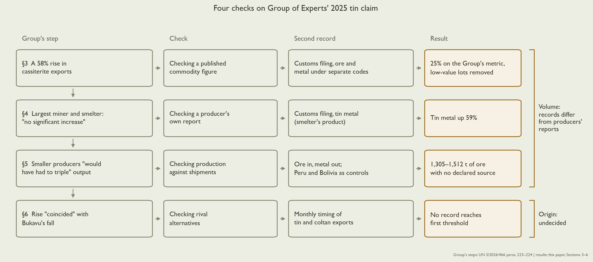
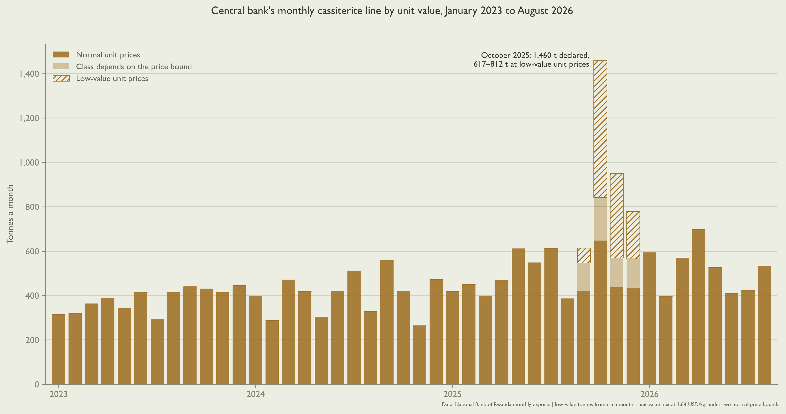
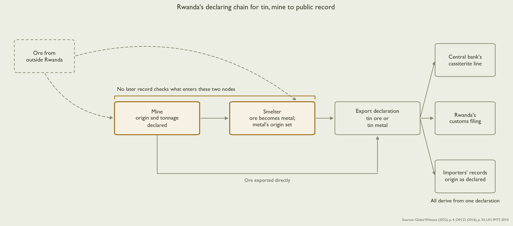
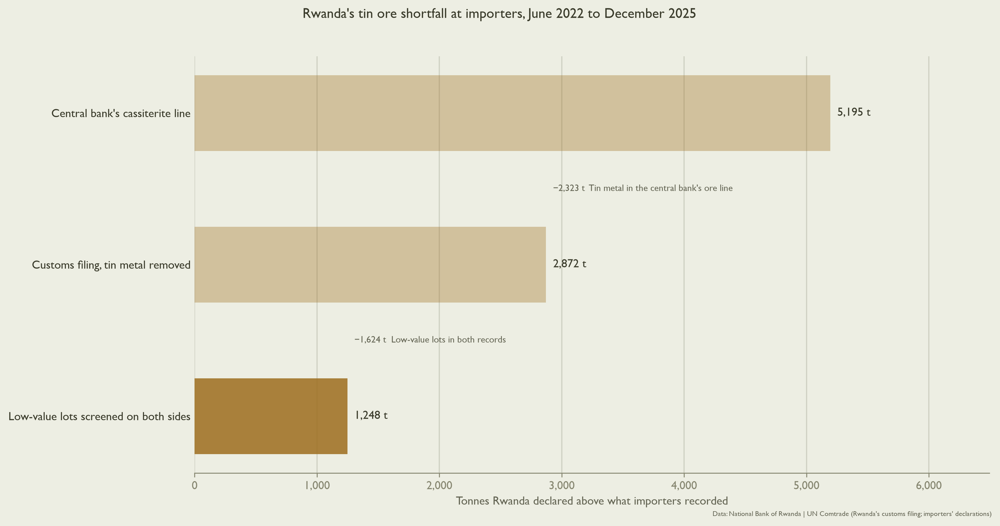
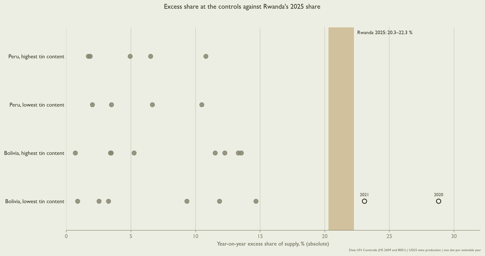
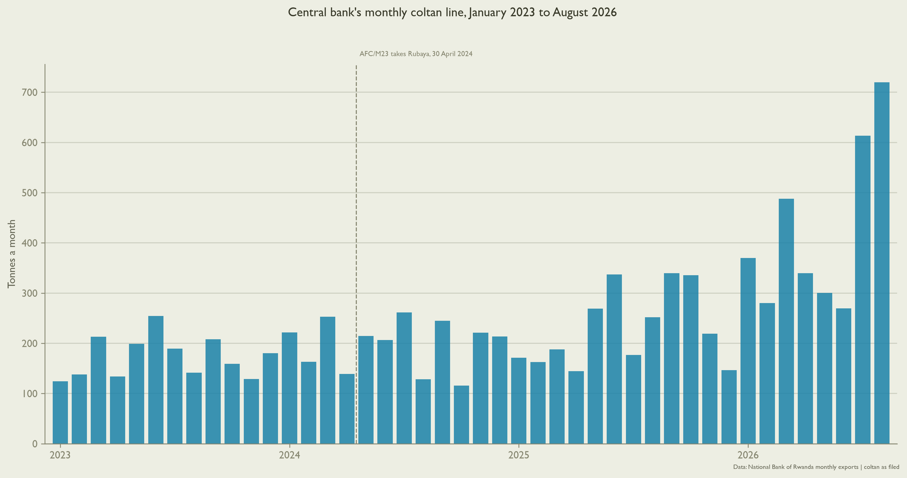

## Summary {.unnumbered}

In June 2026, the UN Group of Experts on the Democratic Republic of the Congo (DRC) reports a 58% rise (2,839 t) in Rwanda's 2025 exports of cassiterite, or tin ore. 

It concludes that this rise is "consistent with increased smuggling" from areas in the DRC controlled by the armed coalition Alliance Fleuve Congo/Mouvement du 23 mars (AFC/M23).[@unsc2026s466] The Group measures this rise using a single figure from one record: exports labeled "cassiterite" by Rwanda's central bank.

This paper checks each step of the Group's analysis using a second public record, Rwandan customs filing (@fig-workflow).

Adding a second record shows that both disagree with exports reported by Rwanda's major tin producers. The recount yields 1,305–1,512 t of tin ore with no declared source. After removing low-value lots, the Group's own metric shows a rise of 25%, not 58%.

Expanding the Group's one alternative explanation to seven shows no public record separates smuggling from the six benign alternatives at the end of its range nearest even odds. Testing mineral origin requires site-level records, which the smelter reports it maintains.

Since 2021, EU importers of tin ores and metals above set annual volumes must carry out supply chain due diligence that follows the Organisation for Economic Co-operation and Development (OECD) guidance.[@eu2017821; @ec2021cmr]

This check gives them a public-records test of a supplier's declared volumes for tin and, in principle, for other regulated minerals.

{#fig-workflow fig-alt="Diagram of four rows, one per section 3 to 6. Each row runs from the Group's step to a check, a second record and a result. A 58% rise becomes 25% on the Group's metric with low-value lots removed. 'No significant increase' encounters tin metal up 59%. The Group's 'would have had to triple' conclusion encounters 1,305–1,512 t of ore with no declared source. 'Coincided' encounters no record reaching the first threshold. A bracket groups the first three as volume and the fourth as origin, undecided."}

## 1. The claim {#sec-claim}

In February 2025, AFC/M23 captures Bukavu, South Kivu's provincial capital. That month marks the "cessation" of the DRC's official State exports of cassiterite from Bukavu.[@unsc2026s466]

In June 2026 the Group reports its 58% rise figure for 2025, peaking in October of that year (@fig-october). The Group adds that the increase "slightly exceeded South Kivu's officially recorded cassiterite production for 2024". 2025 coltan exports also rise. 

The Group interprets this evidence as "temporally and quantitatively consistent" with mineral smuggling into Rwanda from AFC/M23-controlled areas in the DRC.[@unsc2026s466]

{#fig-october fig-alt="Stacked bar chart of the central bank's monthly cassiterite exports in tonnes, January 2023 to August 2026. Split into tonnes at normal unit prices, tonnes whose class depends on the price bound, and hatched tonnes at low-value unit prices. October 2025 is the tallest bar, labeled 1,460 t declared with 617–812 t at low-value unit prices."}

The Group weighs one alternative for explaining the 58% rise: increased production at Rwandan mines, based on what the domestic producers themselves reported to the Group. 

Rwanda's largest miner and its only tin smelter together account for about 60% of 2024 cassiterite exports. Neither reports a significant rise in its 2025 export volumes. 

The Group infers that smaller producers would have had to "triple" their production to cover the rise. 

Rwanda's customs filing reports tin metal exports, the smelter's product, rising from 843 t in 2024 to 1,341 t in 2025. This tin metal tonnage counts for the Group as tin ore. 

Smuggling is just one of seven explanations for the 58% rise and for the gap between the producers' reports and the customs filing. Separating the seven with public records depends on two questions. 

Does any record differ from the volumes the producers report? What about from the origin they declare?

## 2. Why one mineral is hard to trace {#sec-trace}

As it moves from mine to smelter to port, tin ore undergoes changes in its physical properties, reporting classification, and its official origin. 

Where a mineral's properties or classification change from one regime to another, definitive evidence of its initial properties, classification, and origin disappears. Only the domestic operator at each node reports them. 

The result is a single declaring chain that no later record can verify (@fig-chain).

{#fig-chain fig-alt="Flow diagram. A dashed box, ore from outside Rwanda, has dashed arrows into the mine and the smelter. The mine, where origin and tonnage are declared, feeds the smelter, where ore becomes metal and the metal's origin is set. Both are outlined in gold under a bracket reading 'No later record checks what enters these two nodes'. The mine also exports ore directly. Both paths reach the export declaration, which fans out to the central bank's cassiterite line, Rwanda's customs filing and importers' records. All labeling derives from one declaration."}

At work are three main problems:

1. **Mines and smelters erase mineral origins.** 

A mine's tin output – whether concentrate, ore, or residues – receives a single declaration of origin and output. This declaration is unverifiable without physical access to the mine's production.

These declarations are often unreliable. A 2022 Global Witness report notes mineral traders "had declared minerals as coming from one of these mines despite it being common knowledge that it had been inactive for a year".[@globalwitness2022itsci, p. 4] 

"After smelting", the OECD says, tracing mineral origin is "generally unfeasible". Buyers are left to assess the smelter's reported due diligence, not the ore itself.[@oecd2016ddg, p. 33] 

2. **Mines and smelters belong to a single declaring chain.** 

Every record available without a data request is recorded by, or derived from, the same domestic declaring chain. 

These include production statistics, royalties, customs, the central bank's cassiterite line, and importers' origin fields. False declarations pass unscrutinized through a declaring chain.

Where verification tagging exists at sites, Global Witness notes "the bulk of minerals tagged came from unvalidated mines in neighbouring territories". These minerals nonetheless enter the records as verified output.[@globalwitness2022itsci, p. 4] Importers abroad likewise record origin as the declarant reports it.[@unsd2013imts]

3. **Inconsistent classification labels over time and between countries** (@tbl-codes).

For example, the central bank's "cassiterite" line counts tin metal as ore beginning in 2019. The Group derives 7,700 t of "tin ore" from this combined figure (Section 3).

Rwanda declares 1,620.2 t of tin ore exports to Cambodia in 2025, which Cambodia never records importing (Section 3).

To avoid these pitfalls, mirror gap analysis aligns definitions, coverage and processing stage before measuring a commodity's flow.[@unctad2021iff, p. 40; @nitsch2016, p. 5] It cannot measure smuggling before the first record. Smuggled goods "should be excluded" from trade statistics and "recorded separately".[@unsd2013imts]

| Code                                       | What it contains                                                   | How it disrupts analysis                                                                                                                                     |
| ------------------------------------------ | ------------------------------------------------------------------ | ------------------------------------------------------------------------------------------------------------------------------------------------------------ |
| Central bank's "cassiterite" line (not HS) | Rwanda's "cassiterite" exports, as the central bank publishes them | Counts tin metal as ore from 2019; the Group's 7,700 t is this line                                                                                          |
| HS 2609                                    | Tin ores and concentrates                                          | Grade is not recorded, so tonnes of ore do not convert to tonnes of tin; 1,620.2 t declared to Cambodia in 2025 at 1.64 USD/kg, which Cambodia never records |
| HS 8001                                    | Unwrought tin (metal)                                              | The smelter's product, with a new origin; the exporter is not named, and metal imported in 2023–2024 may leave as exports                                    |
| HS 8002                                    | Tin waste and scrap                                                | No imports in 2017–2025, so imported scrap does not feed the rise in tin metal exports                                                                       |
| HS 2620                                    | Slag, ash and residues containing metals                           | Imports at most 3.8 t a year, 2017–2025; retreating Rwanda's own residues leaves no trade record                                                             |
| HS 261590                                  | Other niobium, tantalum and vanadium ores, coltan among them       | Several ores under one heading; Malaysia records 1,826.7 t from Rwanda at 0.8–6.6 USD/kg, which Rwanda never declares                                        |
| HS 2611                                    | Tungsten ores and concentrates                                     | Rwanda declares most of it to trading hubs that record none, so importers record only part                                                                   |

: The codes the analysis crosses, and how each changes an interpretation of the records. HS is the Harmonized System, the international customs code list. {#tbl-codes}

After every label is corrected, a gap remains, though not the one the Group measures. The national mirror shortfall is 1,248 t, June 2022 to December 2025 (@fig-mirror). The UN manual for trade statisticians expects some difference to survive every adjustment, and lists fraud as only one of its causes.[@unsd2013imts] The gap alone is not evidence of smuggled ore.

The Group tests one alternative against smuggling, production at Rwandan mines as the producers report it. Six benign alternatives may explain the same records:

- growth at registered mines;
- unregistered mines;
- release of stocks;
- retreatment of Rwanda's own residues;
- a recording error the declaring chain shares;
- a mix with no majority (Section 6).

{#fig-mirror fig-alt="Three horizontal bars of tin ore that Rwanda declares and importers do not record, June 2022 to December 2025: 5,195 t on the central bank's cassiterite line, 2,872 t on the customs filing with tin metal removed, and 1,248 t with low-value lots screened on both sides. The size of each correction is labeled between the bars."}

The Group interprets the 58% rise as "consistent with increased smuggling". Section 6 tests whether the records are also consistent with the six benign alternatives.

## 3. The series {#sec-series}

The Group derives its 58% from the central bank's cassiterite line, as the central bank publishes it.[@unsc2026s466]

Rwanda's customs filing uses a different classification system where tin ore and tin metal receive separate codes. Customs reports ore plus metal rose 2,828 t in 2025, almost the same rise as the central bank's line (2,839 t).

Yet most of the customs rise is not tin ore sold at ore prices. More than half of it, 1,620 t, is the Cambodia lots. These are tin ore lots declared to Cambodia at a fraction of tin ore's value (1.64 USD/kg, versus 20.2 USD/kg for Rwanda's other tin ore exports that year). Cambodia never records receiving this tonnage. 

Processed tin metal accounts for another 497 t. Without the low-value lots, tin ore rose 731 t.^[The parts sum to the total once the 20 t of low-value lots in 2024 are subtracted.] Lots at the same low unit values also account for much of the October 2025 peak (@fig-october).

> **Checking a published commodity figure**
>
> 1. Find a second source that files the products separately.
> 2. Keep the first source's metric: here, ore plus metal, by weight.
> 3. Remove what is not the commodity at commodity prices, from both years.
> 4. Recompute.

On the Group's own metric, with the low-value lots removed, the rise is 25%, not 58%. A rise nonetheless.

One national total can comprise several products, and the size of a rise depends on which products are counted. Neither record notes where the tonnes came from. For that, the Group turns from the central bank's figures to the producers' own reports.

## 4. The producers' reports {#sec-producers}

The Group tests production at Rwandan mines as the single alternative to smuggling. This test largely rests on two producers, the largest miner and the smelter, that together account for about 60% of 2024 cassiterite exports. The Group notes "neither entity reported any significant increase in their export volumes in 2025."[@unsc2026s466]

In this case, miner and smelter reports arrive from the same declaring chain. Both mines and smelters are sites where declared mineral origin, quality, and classification are set by the declarant and checked by no later record. Declared output at mines can far exceed what a site produces (Section 2).

The largest miner's statements report no significant increase in exports. If true, they clear the miner. Because they do not disclose 2025 export figures, no public record can check their claim.

A traceability scheme can leave such claims unchallenged. In the DRC, one official told investigators that the scheme's agents know "the statistics they declare for certain mines do not represent the reality of those mines' production", but do not challenge them.[@globalwitness2022itsci, p. 42]

Yet Rwanda's customs filing shows tin metal, which Rwanda produces in a single smelter, rising 59% (Section 1). Three caveats apply. Rwanda imported tin metal in 2023 and 2024, and some may have left again. The filing does not name the exporter. And the Group does not say how it measured "export volumes".

> **Checking a producer's own report**
>
> 1. List every claim the report makes that a record could check. Include claims that would clear the producer, like a statement that volumes did not rise.
> 2. Compare each claim against a second record of the same quantity.
> 3. Compare the report with its last edition, and note what stops getting reported.
> 4. Mark which records come from the same source as the report. They cannot confirm it.

And the smelter's annual reports change what they disclose. In 2024 its annual report includes tonnage smelted for clients. Its 2025 report does not. Is mineral tracing simply dependent on the capricious reporting of a handful of producers?

## 5. Ore in, metal out {#sec-ore-metal}

Given the Group's assumption that the two large producers did not account for the 2025 rise, smaller producers must have grown 2.46 times (close to the Group's "triple" finding).

But the smelter's output may have risen. Its product, tin metal, rises 59% on customs (Section 4). To make more tin metal, a smelter requires more tin ore. The smelter presumably purchases more ore from Rwanda's mines, small producers included. Could domestic mines have supplied all the tin ore that Rwanda used in 2025?

Rwanda ships tin in two forms: as ore, and as metal made from ore. Add the ore shipped as ore to the ore needed to make the metal shipped, then subtract the ore Rwanda says it imported. What is left is the ore Rwanda's own mines must have produced (@fig-node-balance).

What cannot be counted from trade statistics is how much tin is contained in each tonne of tin ore. This proportion is estimated using the tin content of pure cassiterite (tin dioxide), at 78.8% by weight, as its upper bound. The lower bound is the ore's declared export value per kilogram divided by tin metal's in the same year, since a tin concentrate is not worth more than the tin it contains. 

> **Checking production against shipments**
>
> 1. Add up all material shipped, converting processed goods back into the raw material they need.
> 2. Subtract the raw material declared as imported.
> 3. Where a conversion is unknown, carry the lowest and highest values to the end.
> 4. Compare the result with what the mines report, and run the same recount where nothing is hidden.

With this recount, the ore Rwanda's mines must have produced rises 41–43% in 2025. Declared ore imports from the DRC fall to 0 t. The US Geological Survey reports 12.2% growth at Rwanda's mines.[@usgs2026] 

Allowing for that growth, 1,305–1,512 t of ore have no declared source. The OECD guidance treats such a mismatch, declared volumes "out of keeping with ... expected production levels", as a "red flag".[@oecd2016ddg, p. 33]

A one-year rise of 41% or more is rare among producers above 1,000 t a year (7.6% of years). Among artisanal producers it is common (31.0%).

The same recount runs on two exporters where no hidden supply is expected, Peru and Bolivia. Rwanda's 2025 share of supply with no declared source is above every Peru year. Bolivia passes it in two years (@fig-controls), because in those years prices could not set a range for the tin content of its ore. This cause was identified only after the result.

The recount finds ore unaccounted for by declared records. It cannot determine where that ore came from. The Group addresses the question of origin through timing.

{#fig-node-balance fig-alt="Line chart of implied Rwanda-origin tin ore in tonnes a year, 2017 to 2025, with a shaded grade band and a dotted 2017–2018 mean. The 2025 point stands well above the mean, and declared ore imports from the DRC run near zero along the bottom."}

{#fig-controls fig-alt="Dot plot of year-on-year excess share of supply, in percent, for Peru and Bolivia at the highest and lowest tin content, one dot per estimable year, against a shaded band for Rwanda's 2025 share of 20.3–22.3%; two open circles for Bolivia at the lowest tin content sit to the right of the band."}

## 6. From two alternatives to seven {#sec-alternatives}

The Group writes that the rise in Rwanda's cassiterite exports "coincided with the cessation of official State exports from Bukavu in February 2025".[@unsc2026s466] The Group establishes no time interval for "coincided". Its annex compares by quarter. 

The Group also notes that Rwanda's coltan exports "followed a similar, although less pronounced, upward trend".[@unsc2026s466] 

The coltan outflow is dated in an earlier Group report. From mid-May 2024, two weeks after AFC/M23 takes Rubaya, "the frequency and volumes of minerals leaving Rubaya were constant", estimated at about 120 t of coltan a month.[@unsc2024s969, para. 64]

The Group's timing is retested month by month. If ore from a captured area enters Rwanda, that mineral's declared exports increase in the month the area falls. 

For tin, these are February 2025, when Bukavu falls, or January 2025, when AFC/M23 takes Goma.[@unsc2025s858] May 2024 is selected for coltan, the month Rubaya and its coltan deposits come under AFC/M23 control.

With foreign ore, Section 2's six benign alternatives make seven. Each predicts a different pattern in the monthly records. @tbl-records lists the records that could separate foreign ore from the domestic alternatives.

In this case records repeat the same initial declarations, whichever alternative is true.

> **Checking rival alternatives**
>
> 1. Write down every alternative that could produce the records before weighing any evidence.
> 2. Simulate each alternative many times on copies of the real records. The share that match the observed record is its likelihood.
> 3. For each record, ask how much more often it would occur under one alternative than under another.
> 4. Decide the threshold criteria before scoring. Before including a new source, simulate whether it can meet your thresholds.

| Record                                                                                             | Separates foreign ore from             | Result                                                                                              |
| -------------------------------------------------------------------------------------------------- | -------------------------------------- | --------------------------------------------------------------------------------------------------- |
| Timing of the rise (parts: tin step†, tin persistence†, size of rise†, coltan and tungsten timing) | All five domestic alternatives         | −0.2 to −9.5 dB, toward the domestic alternatives; short of the first threshold at its cautious end |
| Cross-border declarations                                                                          | All domestic but a recording error     | 0 dB. No such field in 2025: no importer gives a consignment country for DRC ore                    |
| Satellite, DRC sites                                                                               | All domestic but a recording error     | Not run. Power limit of the national test; a site-level test is untested, not run due to cost       |
| Satellite, Rwanda                                                                                  | Registered and unregistered mines only | Not run. Power limit: reaches 3 dB in at most 3.1% of simulated datasets                            |
| Field and third-party records                                                                      | Not known until requested              | Not run. Not public; not requested                                                                  |
| Imported residues†, largest miner's output†, records agreement†, persistence†                      | None                                   | Read, not scored: each narrows a domestic alternative only                                          |

: Which public records could separate foreign ore from the domestic alternatives, and what each found. Values are in decibels, ten times the base-10 logarithm of the likelihood ratio.[@good1985] 3 dB is about twice as likely, 10 dB ten times. Negative values are more likely under the domestic alternatives. † Read before the alternatives were written down. In a Bayesian weighing, the order in which evidence is read does not change the result.[@fairfield2017, sec. 3.3.4] {#tbl-records}

Only the timing of the rise differs between foreign ore and the domestic alternatives. Under the domestic alternatives the rise is more likely. At its cautious end the two sides are almost even, below the first threshold (@fig-timing). 

The difference comes from coltan. Tungsten's timing leans the same way, by less. If Rubaya's ore enters Rwanda at once, Rwanda's declared coltan exports step up soon after. They do not step up in May 2024. They rise later, and gradually (@fig-coltan).

That interpretation assumes foreign ore enters declared exports all at once. Ore held, blended or declared over months would enter gradually. Under a build-up of one to two years, no setting of the simulation reaches the first threshold (@fig-timing).

{#fig-coltan fig-alt="Bar chart of the central bank's monthly coltan exports in tonnes, January 2023 to August 2026. A dashed line at May 2024 marks Rubaya's capture on 30 April 2024. Bars stay between about 115 and 260 t a month through 2024 and early 2025, rise from mid-2025, and reach about 720 t in August 2026."}

The Group's satellite imagery of Rubaya "indicated a substantial increase in mining activity" over a year.[@unsc2026s466, para. 213] Again, this is evidence of more output at the source, not where the output ended up.

The seven alternatives keep their starting weights. The source of the 1,305–1,512 t is undecided. The result returns undecided on the records scored, not on every record that exists. @tbl-records notes why other potential records were not included in this analysis, often due to cost or low evidentiary power.

The Group's customs records, invoices and testimony on Rubaya are on file but not public.[@unsc2026s466, paras. 215–220] They are not scored here. The public records are as consistent with the six benign alternatives as with smuggling.

{#fig-timing fig-alt="Range plot of likelihood ratios in decibels, foreign ore against domestic alternatives, one row per part of the timing record. The whole record runs from about −9.5 to −0.2 dB. Coltan timing alone sits from −6.8 to −1.5 dB. Tin rows sit near zero or slightly positive. Without coltan the record runs from −0.8 to +4.0 dB. Two rows for foreign ore building up over 12–24 months sit between −2.5 and −0.5 dB, within the shaded band of ±3 dB."}

## 7. Limitations and open questions {#sec-limits}

Every public record in this paper begins at a declaration. Ore declared as Rwandan at the mine remains Rwandan in every later record. 

Foreign ore can enter a domestic supply by five channels: undeclared feed at the smelter, ore bought from traders, tolling, auctions of seized minerals, and "dummy mines". These are declaring mine sites which produce "little or no ore" yet are maintained "to legitimise inflated claims of deposits and production".[@rubaii2025, p. 5] Dummy mines are documented in Rwanda.[@globalwitness2022itsci, p. 57] No public record separates one channel from another.

Section 5 accounts for undeclared feed. The other channels still escape the recount. Ore declared as a mine's own output enters the mine growth that the recount subtracts, which shrinks the 1,305–1,512 t instead of adding to it.

In Indonesia's tin corruption case, a supervisor at the state miner testified that most of its 2019 tin ingot came "from our competitors", five privately owned smelters.[@puspadini2024]^[Translation of "dari kompetitor kita"; the supervisor puts the share at about 75%.] 

The state miner declared that tin as its own output, and Indonesia's national smelter figure for 2019 passes through the state miner's declaration.[@usgs2019myb, table 10] Both national and firm-level outputs balance, so even a case of known laundering at the first declaration leaves no gap to detect. The recount is again checked against Peru and Bolivia, exporters where no hidden supply is expected (Section 5).

Each likelihood in Section 6 comes from simulations that plant one alternative into copies of Rwanda's records. The simulations compare the alternatives with each other, not one alternative with its absence. These simulations cannot separate a smuggling network that grows the way a mine grows from domestic growth, because both produce the same monthly records.

The Group dates Rubaya's outflow from mid-May 2024.[@unsc2024s969, para. 64] Rwanda's declared coltan exports rise from mid-2025 (@fig-coltan). What happens to the ore in between is not in any public record.

## 8. The records worth asking for {#sec-meaning}

The result depends on which records are used and which metric is measured on them. It also depends on a third choice: whether to seek records that separate the benign alternatives.

On the Group's metric, national volume as the central bank reports it, the public records disagree with the producers' reports. With the Group's one alternative, only site-level records at the mine and the smelter could separate it from smuggling inside one declaring chain. Public data lack these records.

Customs, a second record from the same chain, files separately the products that the central bank combines. In customs, the smelter's product rises 59% (Section 4). The recount in Section 5 leaves 1,305–1,512 t of ore without a declared source.

So while aggregated public records can indeed locate an arithmetic gap in a country's mineral exports, they still cannot determine the origin of unaccounted-for tin ore.

Site-level records at the smelter could disentangle this tracing problem, whether they are authentic or not. These records are purported to exist. The smelter in Rwanda reports that it checks each supplier's production with geospatial data and site visits, and keeps mineralogical profiles for each mine site.[@luna2026step5, pp. 7, 13, 16]

The smelter's site records would also differentiate and test the dummy mine alternative. Comparing declared output by site with satellite-derived activity at the site would test whether a declaring mine is actually mining.

It does not appear that any national entity records site-level figures. On 2 April 2026 the Group asked Rwanda to clarify "the reported origins of increased cassiterite and coltan exports".[@unsc2026s466] As of 11 June 2026, it is awaiting a response.

## Appendix {.unnumbered #sec-appendix}

@tbl-a1 lists the data sources, @tbl-a2 the parameters and @tbl-a3 the instrument checks. Code and the numbers freeze file are available on request.

| Record                                                                                 | Kept by                                                | Used for                                                                    | URL                                                                                                                                               |
| -------------------------------------------------------------------------------------- | ------------------------------------------------------ | --------------------------------------------------------------------------- | ------------------------------------------------------------------------------------------------------------------------------------------------- |
| Monthly mineral exports: cassiterite, coltan and wolframite lines                      | National Bank of Rwanda                                | The Group's 58% rise; monthly timing (Sections 3 and 6)                     | [bnr.rw](https://www.bnr.rw/documents/Monthly_Exports_m4Ck5l3.xlsx)                                                                               |
| Rwanda's customs filing: tin ore (HS 2609) and tin metal (HS 8001), annual and monthly | UN Comtrade                                            | The series split, the Cambodia lots, the recount (Sections 3 to 5)          | [comtradeplus.un.org](https://comtradeplus.un.org/)                                                                                               |
| Partner filings: Cambodia, Peru and Bolivia                                            | UN Comtrade                                            | The mirror gap; the recount at the two control exporters (Sections 2 and 5) | [comtradeplus.un.org](https://comtradeplus.un.org/)                                                                                               |
| Mine production of tin, by country                                                     | US Geological Survey, Mineral Commodity Summaries 2026 | Rwanda's 12.2% mine growth; control-exporter mine output (Section 5)        | [pubs.usgs.gov](https://pubs.usgs.gov/periodicals/mcs2026/mcs2026-tin.pdf)                                                                        |
| Group of Experts reports S/2024/969, S/2025/858, S/2026/466                            | UN Security Council                                    | The Group's figures, dates and quotations (Sections 1 and 6)                | [S/2024/969](https://docs.un.org/en/S/2024/969), [S/2025/858](https://docs.un.org/en/S/2025/858), [S/2026/466](https://docs.un.org/en/S/2026/466) |

: Data sources. Every record is public. {#tbl-a1}

| Parameter                         | Value                                                                          | Section |
| --------------------------------- | ------------------------------------------------------------------------------ | ------- |
| Tin content of ore, upper bound   | 78.8% by weight (pure cassiterite)                                             | 5       |
| Tin content of ore, lower bound   | Ore export value per kilogram divided by tin metal's, same year                | 5       |
| Domestic mine growth, 2025        | 12.2% (US Geological Survey)                                                   | 5       |
| Baseline for Rwanda-origin ore    | 2017–2018 mean                                                                 | 5       |
| Capture months                    | Rubaya, May 2024; Goma, January 2025; Bukavu, February 2025                    | 6       |
| Foreign ore build-up variant      | 12–24 months                                                                   | 6       |
| Alternatives and starting weights | Seven, equal                                                                   | 6       |
| Evidence thresholds               | 3 dB (about twice as likely) and 10 dB (ten times)                             | 6       |
| Simulated records                 | 120 conditions, 8,000 runs each, 960,000 in total                              | 6       |
| Settings scored at the case       | 24: 2 generator families, 3 block lengths, 2 tin-content bounds, 2 size halves | 6       |

: Parameters. {#tbl-a2}

| Check                                                                         | Result                                                                                                                          | Outcome                                                                                                  |
| ----------------------------------------------------------------------------- | ------------------------------------------------------------------------------------------------------------------------------- | -------------------------------------------------------------------------------------------------------- |
| Reliability: predicted against observed likelihood, held-out generator family | 0.04 predicted, 0.05 observed in the lowest bin; 0.96 predicted, 0.91 observed in the highest                                   | Passes                                                                                                   |
| Detection: score rises with the share of foreign ore planted                  | Median −6.1 to −6.6 dB with no foreign ore; +2.1 to +2.3 dB with half the rise foreign; +7.5 to +10.3 dB with all of it foreign | Passes                                                                                                   |
| Zero size: with no foreign ore planted, each pair of alternatives scores 0 dB | Every domestic alternative writes a gradual rise and foreign ore a step, so the pairwise scores lean against foreign ore        | Fails. Pairwise scores are dropped; foreign ore is scored against the domestic alternatives as one group |
| Group check: foreign ore against the domestic alternatives as one group       | Median +5.1 to +5.8 dB with foreign ore true; −5.5 to −6.8 dB with a domestic alternative true                                  | Passes                                                                                                   |

: Instrument checks on the simulations behind Section 6, run before the case was scored. {#tbl-a3}
